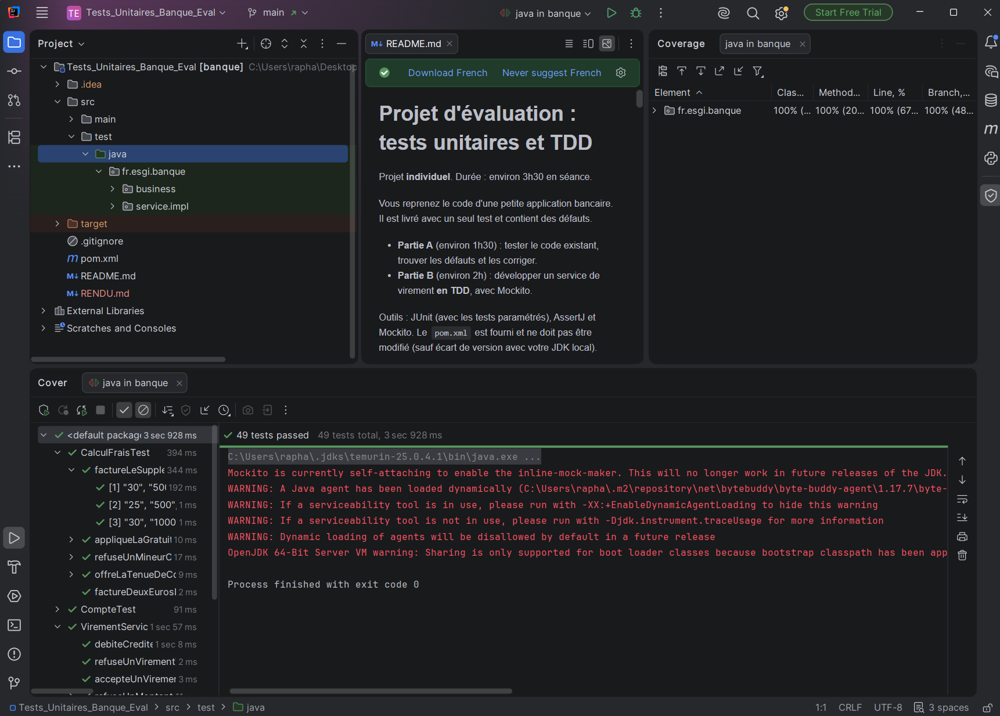

# Rendu : tests unitaires et TDD

- **Nom :** Sanchez (Jacq, mon ancien nom, qui apparaît encore comme auteur des commits)
- **Prénom :** Raphaël
- **Campus :** Eductive Aix-en-Provence (ESGI 3)

## Partie A : défauts trouvés et corrigés

Pour chaque défaut, le test qui le prouve a été commité seul (`test:`), puis la correction (`fix:`).

| Règle | Défaut constaté | Test qui le prouve |
| --- | --- | --- |
| C3 | `crediter` acceptait un montant de 0 (test `signum() < 0` au lieu de `<= 0`). | `CompteTest.refuseUnCreditSansMontantStrictementPositif` |
| C5 | Un débit qui amenait le solde exactement à `-découvertAutorisé` était refusé (`<= 0` au lieu de `< 0`). | `CompteTest.accepteUnDebitJusquaLaLimiteDuDecouvert` |
| C6 | `estVide()` utilisait `equals`, donc un solde de `0.00` n'était pas considéré comme vide. | `CompteTest.reconnaitUnSoldeNulQuelleQueSoitSonEchelle` |
| F3 | La tenue de compte était offerte à 26 ans (`<= 26` au lieu de `< 26`). | `CalculFraisTest.appliqueLaGratuiteAuxMoinsDeVingtSixAns` |
| F4 | Un solde moyen de 1 000 € pile ne donnait pas la gratuité (`> 1000` au lieu de `>= 1000`). | `CalculFraisTest.offreLaTenueDeCompteDesMilleEuros` |
| F5 | Le supplément premium n'était plus facturé quand la tenue était offerte (retour anticipé à 0). | `CalculFraisTest.factureLeSupplementPremiumMemeSiLaTenueEstOfferte` |

Les règles C1, C2, C4, C7, F1 et F2 étaient respectées : elles sont couvertes par des tests sans correction.

### Tests par règle

| Règle | Tests |
| --- | --- |
| C1 | `refuseUnNumeroOuUnTitulaireManquant` |
| C2 | `refuseUnSoldeOuUnDecouvertInvalide`, `accepteUnDecouvertAutoriseNul` |
| C3 | `shouldIncreaseBalanceWhenCrediting`, `refuseUnCreditSansMontantStrictementPositif` |
| C4 | `refuseUnDebitSansMontantStrictementPositif` |
| C5 | `accepteUnDebitJusquaLaLimiteDuDecouvert`, `refuseUnDebitAuDelaDuDecouvertSansChangerLeSolde` |
| C6 | `reconnaitUnSoldeNulQuelleQueSoitSonEchelle` |
| C7 | `indiqueSiLeCompteEstADecouvert` |
| F1 | `refuseUnMineurOuUnSoldeMoyenManquant` |
| F2 | `factureDeuxEurosDeTenueDeCompte` |
| F3 | `appliqueLaGratuiteAuxMoinsDeVingtSixAns` (18, 25 et 26 ans) |
| F4 | `offreLaTenueDeCompteDesMilleEuros` (999,99 / 1 000 / 1 000,01 €) |
| F5 | `factureLeSupplementPremiumMemeSiLaTenueEstOfferte` |

## Partie B : service de virement

Toutes les règles V1 à V7 sont terminées, chacune avec un cycle `red:` / `green:` / `refactor:` dans l'historique.

| Règle | Tests |
| --- | --- |
| V1 | `refuseUnMontantNonPositifOuAbsent` (null, 0, -0,01) |
| V2 | `refuseUnVirementVersLeMemeCompte` |
| V3 | `refuseUnVirementSiLeCompteSourceEstIntrouvable`, `refuseUnVirementSiLeCompteDestinationEstIntrouvable` |
| V4 | `debiteCrediteEtSauvegardeLesComptesAvecLaDateDuJour` |
| V5 | `propageLeSoldeInsuffisantSansSauvegarderNiCrediter` |
| V6 | `alerteLeTitulaireSourceAuDelaDeDixMilleEuros` (10 000,01 €), `neDeclenchePasDAlerteADixMilleEuros` (10 000 €) |
| V7 | `refuseUnVirementLeDimancheSansSauvegarder`, `accepteUnVirementLeSamedi` |

Remarque sur V5 : le test est passé dès son écriture, sans phase rouge. Le code de V4 appelait déjà `debiter` avant le crédit et les sauvegardes, donc la `SoldeInsuffisantException` remontait sans que rien ne soit sauvegardé. Il a été commité en `test:` plutôt qu'en `red:`.

Doublures utilisées : `CompteRepository` est un bouchon (`when(...).thenReturn(Optional.of(...))`) et sert aussi à vérifier les sauvegardes (`verify`, `never()`). `NotificationService` sert uniquement à la vérification (`verify`, `verifyNoInteractions`). La date est fixée avec `Clock.fixed(...)`.

## Couverture de code

49 tests, tous au vert. Couverture : 100 % des lignes et 100 % des branches.

